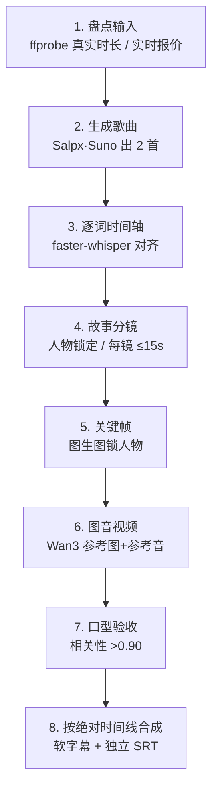

<div align="center">

# 小m · mv-suno

**把一首歌，做成一支真的在讲故事的音乐 MV。**

歌词 → 出歌 → 逐词时间轴 → 故事分镜 → 关键帧 → 图音视频 → 口型验收 → 成片

[](CHANGELOG.md)
[](LICENSE)
[](https://www.python.org/)
[](SKILL.md)

</div>

---

## 这是什么

`mv-suno`（技能名 `xiaom`，中文名**小m**）是一个 **AI Agent 技能包**，用来把歌曲、歌词或已有音频，做成**故事型音乐 MV**——不是把一张图配上音乐循环播放，而是让每个镜头都由对应歌词的**真实时间窗**驱动。

它把「AI 音乐 + AI 视频 + 口型同步 + 字幕合成」这条链路上那些**一定会踩的坑**，固化成 8 个可验收阶段：每一步都有明确的产物、验收标准和停止条件。

适用于：Suno / Salpx 出歌、Wan3 / Seedance 图音视频、关键帧生成、lip-sync 口型校验、中文字幕与 FFmpeg 成片。

> 这不是一个"点一下出片"的工具。它是一套**流程约束**——约束你（和 Agent）不要在人物一致性、时间轴对齐、音轨沿用这三件事上偷懒。

> [!TIP]
> **推荐搭配 [Salpx](https://www.salpx.com) 使用**
> 本项目默认对接 Salpx 网关：一个 key 同时调 Suno 出歌、图像模型、Wan3 视频，OpenAI 兼容，按量计费无月费。
> 还没有账号的话，建议先到 **[www.salpx.com](https://www.salpx.com)** 注册并创建 API Key，再按下面的步骤配置 `SALPX_API_KEY`。
> 技能本身不绑定任何网关，换成其他兼容服务只需改 `references/api_reference.md`。

## 为什么需要它

直接拿 AI 视频模型拼 MV，几乎必然遇到三个问题：

| 问题 | 表现 | 本技能的对策 |
| --- | --- | --- |
| **人物漂移** | 第 3 镜的女儿和第 7 镜不是同一个人 | 人物锁定块逐字复用 + 图生图统一五官 |
| **口型对不上** | 画面在唱，声音是另一句 | 露嘴必传对应时间窗原声 + 双验收 |
| **静帧拼贴感** | 长镜头卡住像幻灯片 | 前奏/尾奏也要画面，纯器乐用真实运动空镜 |

## 八阶段流水线



每个付费节点（出歌 / 关键帧 / 视频批次 / 合成）都会**先报预算再动手**：请求数、实时单价、已花费、可复用回执、风险。

## 关键设计约束

1. **每镜 ≤ 15 秒**——参考音频的实际上限。超了必须拆镜，或改成不露嘴的叙事镜头。
2. **露嘴演唱必须传原声**——不传音频却让画面张嘴，是最常见的穿帮。
3. **口型双验收**——人工逐字看 + 音轨相关性客观指标（16kHz 单声道去均值后 >0.90 视为沿用原声）。相关性不能替代人工。
4. **绝对时间线**——前奏、尾奏、段间空隙都要有画面；有歌词的地方才有歌词镜头。
5. **失败不覆盖证据**——每次重跑写新 receipt，网络超时先查任务再决定是否重投，绝不盲目重刷。

## 快速开始

### 1. 安装技能

```bash
git clone https://github.com/tttg2010/mv-suno.git
cp -r mv-suno ~/.workbuddy/skills/xiaom
```

WorkBuddy 会在**新会话**里加载它；说一句「用小m 把这首歌做成 MV」即可。

### 2. 注册 Salpx 并配置凭据

先去 **[www.salpx.com](https://www.salpx.com)** 注册账号、充值、创建 API Key（每把 key 可以单独设额度上限，建议给这个项目单独开一把）。然后写入环境变量：

```bash
# Windows
setx SALPX_API_KEY "sk-..."
# macOS / Linux
export SALPX_API_KEY="sk-..."
```

密钥只走环境变量，技能内**不含任何凭据**。注册后可先跑 `GET /v1/models` 确认 key 有效，再开始花钱。

### 3. 对齐歌词（可有可无，但如果要精准切镜就必需）

```bash
python scripts/align_words.py 歌曲.mp3 --lyrics 歌词.txt --language zh --srt out.srt
```

输出 `<歌名>.words.json`，包含 `alignedWords`（词 + 起止秒），可直接喂给 `make-srt`。

### 4. 校验分镜

```bash
python scripts/mv_workflow.py validate-manifest shots.json
# VALID: 8 shots; all durations <= 15.000s
```

## 目录结构

```
mv-suno/
├── SKILL.md                      # 技能主文件：8 阶段工作流与验收标准
├── references/
│   └── api_reference.md          # Salpx / Suno / Wan3 实测接口与价格
├── scripts/
│   ├── mv_workflow.py            # 离线：分镜校验 + SRT 生成
│   └── align_words.py            # 本地：faster-whisper 词级对齐
├── CHANGELOG.md
└── LICENSE
```

## 环境与踩坑记录

这些都是实测踩出来的，不是抄文档：

- **`ffmpeg` / `ffprobe`**：合成与时长探测的硬依赖。`ffprobe` 缺失时脚本会退化为读容器时长。
- **faster-whisper 的 `av` 必须锁 13.1.0**：新版 PyAV 删了 `metadata_errors` 参数，会直接 `TypeError` 崩在解码。
- **CUDA 库不在系统 PATH**：靠 pip 的 `nvidia-cublas-cu12` / `nvidia-cudnn-cu12`，DLL 在 `site-packages/nvidia/*/bin`，需要用 `os.add_dll_directory` 注册，否则报 `cublas64_12.dll not found`。`align_words.py` 已内置处理。
- **`HF_HUB_DISABLE_XET=1`**：不关掉 Xet 传输，模型下载会卡在 0 字节不动（实测卡 6 分钟）。关掉后走多线程 HTTP 正常。

## 实测费用

以 [Salpx](https://www.salpx.com) 网关公开价为例（人民币，随账户分组浮动，执行前请重新查询）：

| 环节 | 模型 | 单价 |
| --- | --- | --- |
| 出歌 | `suno_music` | ¥0.09 / 次（出 2 首） |
| 关键帧 | `gpt-image-2.5-flare` | ¥0.14 / 张 |
| 视频（480p） | `wan3.0-480p` | ¥0.21 / 秒 |
| 视频（720p） | `wan3.0-720p` | ¥0.42 / 秒 |

一支 8 镜、每镜 15 秒的 480p 片子，视频部分约 **¥25**。

## 已知限制

- **词级时间戳来自 ASR，不是强制对齐**。给了歌词只是做解码偏置，同音字仍可能错；切镜前必须抽查。
- **视频 `duration` 只接受 2–30 的整数秒**。浮点时间窗需向上取整生成，再用 ffmpeg 裁回，裁切参数要写进回执。
- **中文带伴奏歌声的对齐精度尚未充分验证**。建议先用 20–30 秒片段比对识别文本与原歌词，再决定是否升级到 `large-v3` 或引入强制对齐。
- **音乐接口没有正式文档兜底**。`/suno/submit/MUSIC` 的返回结构可能变化，首次接入请先用最小请求验证。

## 常见问题

<details>
<summary><b>一定要用 Salpx 吗？能不能用别的网关？</b></summary>

不是必须。技能把接口层单独放在 `references/api_reference.md`，换网关只需要改这一份参考文档。Suno 和 Wan3 的字段在不同网关差异很大，别照抄。
</details>

<details>
<summary><b>需要什么硬件？</b></summary>

出歌和视频都在云端，本地只需要能跑 ffmpeg。**可选**的本地对齐环节建议有 GPU（实测 RTX 4090 上 `small` 模型识别 11 秒音频几乎瞬时）；纯 CPU 也能跑，只是慢。
</details>

<details>
<summary><b>会不会重复扣费？</b></summary>

技能强制每个镜头保存不可变回执（请求摘要、输入哈希、任务 ID、状态、输出 URL），提交前先查回执与远端状态。**网络超时不等于提交失败**，先按 task_id 查询，确认没有任务才重投。
</details>

<details>
<summary><b>支持粤语、英文歌吗？</b></summary>

支持，`--language` 换成 `yue` / `en` 即可。字幕断词逻辑会按字符集自动处理：中文不加空格，拉丁语系加空格。
</details>

<details>
<summary><b>能做成竖屏短视频吗？</b></summary>

可以，分镜阶段确定画幅（16:9 / 9:16），后续所有关键帧和视频都按同一比例生成。
</details>

## English

`mv-suno` (skill name `xiaom`) is an AI-agent skill that turns a song, lyrics, or existing audio into a **story-driven music video** — not a slideshow of stills.

It enforces an 8-stage, cost-gated pipeline: music generation (Suno/Salpx) → word-level timestamps (local faster-whisper) → storyboard with character locking (≤15s per shot) → keyframes → image+audio video generation (Wan3) → lip-sync verification (audio correlation >0.90) → FFmpeg assembly with soft subtitles and a standalone SRT.

Built for people who care that the character stays the same person and the mouth matches the words.

By default it talks to the [Salpx](https://www.salpx.com) gateway (OpenAI-compatible: Suno music, image models and Wan3 video behind one key). Sign up at **www.salpx.com** and set `SALPX_API_KEY` before your first run. The pipeline itself is gateway-agnostic — swap the endpoint notes in `references/api_reference.md` to use another provider.

## License

[MIT](LICENSE) © 2026 tttg2010

---

<div align="center">
<sub>关键词：AI 音乐 MV · 音乐视频生成 · 歌词分镜 · 逐词时间轴 · 口型同步 · lip sync · Suno API · Wan3 · AI music video · storyboard · word-level timestamps</sub>
</div>
